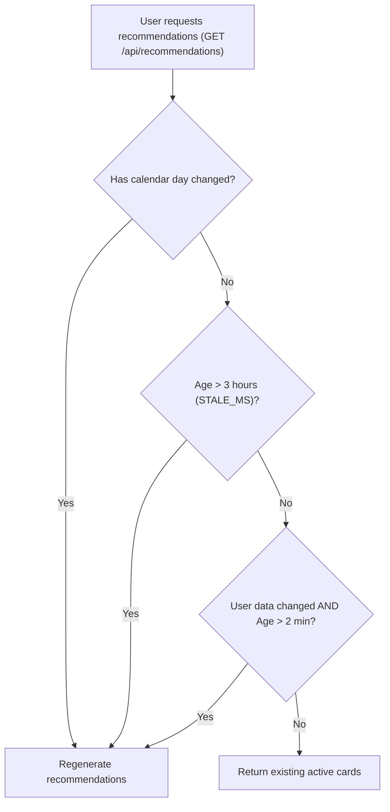
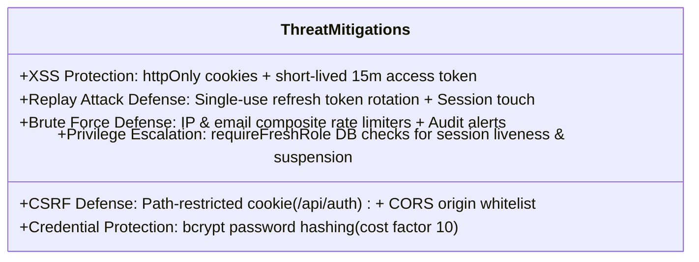
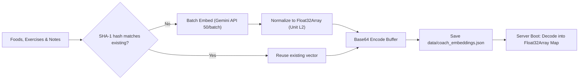
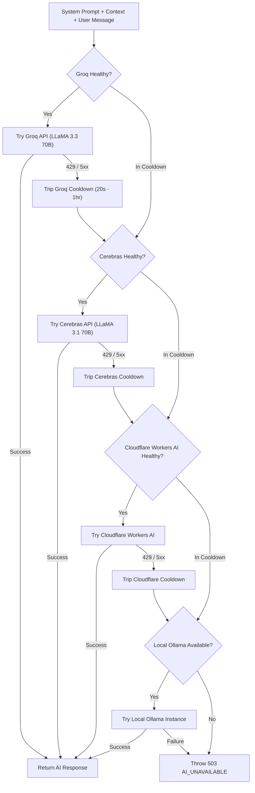
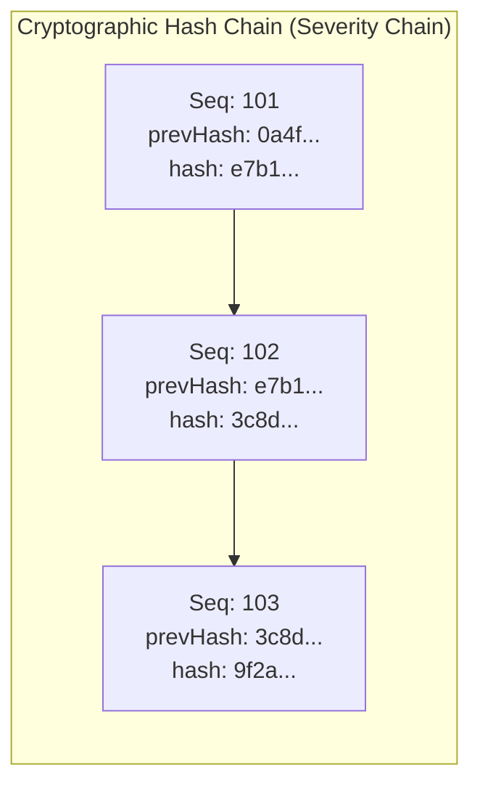

# NutriFitAI System Technical Behaviors & Architecture Specification

This document provides an in-depth technical analysis of the core backend and client-side mechanisms powering **NutriFitAI**. It covers recommendation generation and refresh lifecycles, authentication and session management security, semantic vector embeddings, AI routing failover architectures, safety guardrails, and cryptographic audit logging.

---

## Table of Contents
1. [Recommendation System & Refresh Mechanics](#1-recommendation-system--refresh-mechanics)
   - [Overview & Card Schema](#overview--card-schema)
   - [Automatic vs. Manual Refresh Triggers](#automatic-vs-manual-refresh-triggers)
   - [Cooldowns, Daily Quotas & Concurrency Deduplication](#cooldowns-daily-quotas--concurrency-deduplication)
   - [Algorithmic Candidate Generation & Ranking Pipeline](#algorithmic-candidate-generation--ranking-pipeline)
   - [Safety Gating & Demographic Protections](#safety-gating--demographic-protections)
2. [Authorization, Tokens & Session Security](#2-authorization-tokens--session-security)
   - [Dual-Token Architecture (Access vs. Refresh)](#dual-token-architecture-access-vs-refresh)
   - [Token Storage Strategy: Memory, AsyncStorage & httpOnly Cookies](#token-storage-strategy-memory-asyncstorage--httponly-cookies)
   - [Session Tracking & Centralized Device Management](#session-tracking--centralized-device-management)
   - [Refresh Token Rotation (RTR) & Absolute Ceilings](#refresh-token-rotation-rtr--absolute-ceilings)
   - [Threat Modeling & Attack Defense (XSS, CSRF, Replay, Brute Force)](#threat-modeling--attack-defense-xss-csrf-replay-brute-force)
   - [Multi-Factor Authentication (MFA) & Password Reset Challenges](#multi-factor-authentication-mfa--password-reset-challenges)
3. [Vector Embeddings & Semantic Search](#3-vector-embeddings--semantic-search)
   - [Conceptual Overview: Layman's Terms](#conceptual-overview-laymans-terms)
   - [Deep Dive: Technical Terms & Mathematical Formulation](#deep-dive-technical-terms--mathematical-formulation)
   - [Offline Vector Pre-Computation & In-Memory Indexing](#offline-vector-pre-computation--in-memory-indexing)
   - [Query-Time Embedding Pipeline & LRU Caching](#query-time-embedding-pipeline--lru-caching)
   - [Circuit Breaker, Quota Management & Deterministic Fallback](#circuit-breaker-quota-management--deterministic-fallback)
4. [Additional Core Technical Behaviors](#4-additional-core-technical-behaviors)
   - [Multi-LLM Dynamic Routing & Provider Failover Chain](#multi-llm-dynamic-routing--provider-failover-chain)
   - [AI Coach Safety Guardrails & Crisis Interception](#ai-coach-safety-guardrails--crisis-interception)
   - [Tamper-Evident Append-Only Audit Logging with Hash Chains](#tamper-evident-append-only-audit-logging-with-hash-chains)
   - [Background Scheduled Maintenance & Data Retention Services](#background-scheduled-maintenance--data-retention-services)
   - [Resilient Mobile-Web Network Client & Offline Caching](#resilient-mobile-web-network-client--offline-caching)

---

## 1. Recommendation System & Refresh Mechanics

The NutriFitAI dashboard displays personalized daily recommendations categorized into three kinds: **food**, **workout**, and **general** insights. Recommendations are generated through a hybrid heuristic-AI pipeline defined in `backend/src/controllers/recommendationController.js`.

### Overview & Card Schema
Recommendations are stored in MongoDB under the `recommendations` collection (`backend/src/models/recommendations/Recommendation.js`). Each record contains:
- `userId`: Reference to the user.
- `day`: Calendar day in `YYYY-MM-DD` format according to the user's localized time zone (`X-Timezone` header).
- `kind`: `'food'` | `'workout'` | `'general'`.
- `title` & `body`: Concise, friendly suggestions (max 60 chars for title, 240 chars for body).
- `detail`: Nutritional macros or exercise equipment requirements.
- `ref`: Unique candidate identifier (e.g., `f12` for food items, `r65a12x5` for workout routines).
- `exercises`: Array of `{ exerciseRef, exerciseName, targetSets, targetReps }` for interactive workout creation.
- `source`: `'ai'` (LLM selected) or `'rule'` (heuristic fallback).
- `status`: `'new'` | `'dismissed'` | `'done'`.
- `feedback`: `'up'` | `'down'` | `null`.

### Automatic vs. Manual Refresh Triggers
Recommendations do not update randomly; they are governed by strict freshness thresholds:



1. **Automatic Triggers (Staleness & Invalidation)**:
   - **Calendar Day Rollover**: When the user opens the app on a new day (computed via `today(timeZone)`), the previous day's cards are retired and fresh recommendations are generated.
   - **Stale Time Window (`STALE_MS = 3 hours`)**: On any `GET /api/recommendations` request, if the existing cards were generated more than 3 hours ago, the backend automatically triggers regeneration on the fly.
   - **Data Mutation Invalidation (`CHANGED_MIN_MS = 2 minutes`)**: Whenever the user logs, edits, or deletes a meal (`foodController.js:252, 276, 296`) or updates their profile and fitness goals (`profileController.js:258, 306`), `invalidateRecommendations(userId)` adds the user ID to an in-memory `changed` Set. If at least 2 minutes have elapsed since the last generation, the next `GET` call regenerates recommendations to reflect the new caloric or nutritional balance.

2. **Manual Triggers (User-Initiated)**:
   - Triggered when the user taps "Refresh" in the application (`POST /api/recommendations/refresh`).

### Cooldowns, Daily Quotas & Concurrency Deduplication
To protect AI provider quotas and database resources:
- **Refresh Cooldown**: `REFRESH_COOLDOWN_MS = 1 hour (3,600,000 ms)`. Users must wait at least 60 minutes between manual refreshes. Calling the endpoint prematurely yields HTTP `429 Too Many Requests`: *"These were just updated. Try again in a little while."*
- **Daily Refresh Limit**: `MAX_REFRESHES = 3`. Users can manually refresh at most 3 times per calendar day. Attempting a 4th refresh returns HTTP `429`: *"You can refresh 3 times a day. Come back tomorrow."*
- **Concurrency Deduplication**: An in-memory Map `inflight` caches pending generation promises per `userId`. If multiple rapid requests hit the server concurrently, they attach to the exact same promise rather than spawning duplicate LLM calls or database transactions.
- **State Preservation**: When regeneration occurs, `Recommendation.replaceOpen` deletes only cards with status `'new'`. Cards that the user already `'dismissed'` or marked as `'done'` are preserved for that day, and their references are placed in a blacklist (`seen` Set) so the generator never repeats a dismissed or completed card on that calendar day.

### Algorithmic Candidate Generation & Ranking Pipeline
Recommendations are selected using a two-stage filter-and-rank pipeline:

1. **Candidate Pool Creation (Deterministic & Heuristic)**:
   - **Food Candidates**: Evaluates `data/nutrition_data.json`.
     - Matches against user preferences using dietary regex filters (`MEAT`, `FISH`, `DAIRY`, `GLUTEN`, `PORK`).
     - Ensures the food fits remaining calories: $80 \le \text{food.kcal} \le \min(\text{kcalLeft}, 700)$, where $\text{kcalLeft} = \text{goal.dailyCaloriesKcal} - \text{eaten.caloriesKcal}$. If $\text{kcalLeft} < 150$, food candidates are omitted.
     - Computes a candidate score prioritizing protein density:
       $$\text{Score} = \left(\frac{\text{food.protein}}{\text{food.kcal}}\right) \times (0.8 + 0.4 \times \text{random}())$$
     - Top 5 candidates are retained.
   - **Workout Routine Candidates**: Evaluates MongoDB workout catalog.
     - Matches equipment filters (`equipment: 'none'` for bodyweight, or specific gear).
     - Queries the user's completed sessions over the last 14 days (`WorkoutSession.findRecent`).
     - Groups catalog exercises into balanced routines (3 to 5 exercises per routine, 3 sets $\times$ 10 reps).
     - Prioritizes muscle groups that have **not** been trained in the past 14 days (`freshness` score).
2. **AI Ranking & Friendly Framing**:
   - The candidate pools and user context are passed to `chatRec` (invoking the dedicated recommendation AI chain via `backend/src/services/ai/router.js`).
   - The LLM receives strict instructions: choose up to 3 cards, return **strictly JSON**, avoid numbers in workout cards, talk in everyday muscle terms (shoulders, legs, core), and formulate single-sentence warm encouragements.
   - The output is validated with Zod (`aiCardsSchema`). If parsing succeeds, the cards are stored.
3. **Graceful Fallback**:
   - If the AI provider fails, times out, or returns malformed JSON, the system catches the error (`console.warn`) and immediately falls back to rule-based candidate picking (`source: 'rule'`). The user never experiences an error screen.

### Safety Gating & Demographic Protections
- **Minors (< 18 years old)**: Specific calorie counts and restrictive dietary recommendations are strictly suppressed. If the user is a minor, or has recorded health conditions (e.g., diabetes, hypertension), the system injects a static safety nudge card (`FOOD_NUDGE`): *"Meals that suit your health needs — Ask Nori for ideas that fit."* directing them to safe, conversational guidance.

---

## 2. Authorization, Tokens & Session Security

NutriFitAI implements an enterprise-grade authentication and session management architecture based on cryptographic JSON Web Tokens (JWT) and stateful MongoDB session tracking.

```mermaid
sequenceDiagram
    autonumber
    actor Client as Mobile/Web Client
    participant Auth as Auth Middleware & Router
    participant SessionDB as MongoDB (auth_sessions)
    participant UserDB as MongoDB (users)

    Client->>Auth: POST /api/auth/login { email, password }
    Auth->>UserDB: Validate credentials & password hash
    Auth->>SessionDB: Session.open(userId, ip, userAgent, expiresAt)
    Note over Auth: Sign Access Token (15m, JWT_ACCESS_SECRET)<br/>Sign Refresh Token (1d/7d, JWT_REFRESH_SECRET)
    Auth-->>Client: Set-Cookie: nf_refresh=... (httpOnly, Secure, /api/auth)<br/>Body: { accessToken, user }
    
    Note over Client: Stores accessToken in Memory + AsyncStorage<br/>Cookie stored securely by browser/OS

    Client->>Auth: GET /api/data (Authorization: Bearer <accessToken>)
    Auth->>Auth: verifyAccessToken (signature & expiry)
    Auth-->>Client: 200 OK Response

    Note over Client: 15 minutes elapse; accessToken expires
    Client->>Auth: GET /api/data (Expired Token)
    Auth-->>Client: 401 Unauthorized
    
    Note over Client: apiClient intercepts 401 & calls refresh
    Client->>Auth: POST /api/auth/refresh (Cookie: nf_refresh)
    Auth->>Auth: verifyRefreshToken
    Auth->>SessionDB: Session.touch(sid, userId, expiresAt)
    Note over Auth: Verify account holds & session ceiling (sxp)<br/>Rotate Refresh Token & issue new Access Token
    Auth-->>Client: Set-Cookie: nf_refresh=<rotated> (httpOnly)<br/>Body: { accessToken }
    Client->>Auth: Re-attempt GET /api/data (New accessToken)
    Auth-->>Client: 200 OK Response
```

### Dual-Token Architecture (Access vs. Refresh)

| Property | Access Token | Refresh Token |
| :--- | :--- | :--- |
| **Token Type** | Stateless Bearer JWT | Stateful Session JWT |
| **Signing Secret** | `JWT_ACCESS_SECRET` | `JWT_REFRESH_SECRET` |
| **Signing Algorithm**| HMAC-SHA256 (`HS256`) | HMAC-SHA256 (`HS256`) |
| **Lifespan (TTL)** | `15 minutes` (default) | `1 day` (standard) / `7 days` (Remember Me) |
| **Session Ceiling** | Bound to token expiry | `3 days` (standard) / `30 days` (Remember Me) |
| **Payload Claims** | `sub` (userId), `email`, `role`, `type: 'access'`, `sid` | `sub` (userId), `type: 'refresh'`, `rmb` (rememberMe boolean), `sxp` (absolute ceiling timestamp), `sid` |
| **Purpose** | Authorizes API endpoints | Rotates access tokens and extends active sessions |

### Token Storage Strategy
1. **Refresh Token (`nf_refresh`)**:
   - Stored in an **`httpOnly` cookie**.
   - `httpOnly: true`: JavaScript running inside the browser or web view **cannot** access, read, or export the cookie via `document.cookie`.
   - `secure: true` (in production/HTTPS): Ensures transmission solely over encrypted TLS tunnels.
   - `sameSite: 'none'` (with HTTPS) or `'lax'` (local HTTP): Prevents cross-site leakage while supporting native/web mobile clients.
   - `path: '/api/auth'`: **Critically scoped**. The browser will *only* transmit this cookie to endpoints starting with `/api/auth` (e.g., `/api/auth/refresh`, `/api/auth/logout`). Requests to `/api/food`, `/api/workouts`, or third-party domains never include the refresh cookie.
2. **Access Token**:
   - In the frontend (`frontend/src/shared/utils/authStorage.js`), the access token is kept in an in-memory variable (`cachedToken`) for instant access and persisted to React Native `AsyncStorage` under `nutrifit.accessToken`.
   - Attached to outgoing HTTP requests via the header: `Authorization: Bearer <token>`.

### Session Tracking & Centralized Device Management
While JWTs are cryptographically self-contained, NutriFitAI maintains stateful session records in MongoDB (`auth_sessions` collection) to enable immediate revocation:
- Each login generates a unique Session ID (`sid = crypto.randomUUID()`) placed in both tokens.
- The `auth_sessions` collection tracks:
  - `_id`: Session ID (`sid`).
  - `userId`: Account reference.
  - `ip`: IP address of the client device.
  - `userAgent`: Client operating system / browser string (truncated to 200 chars).
  - `lastUsedAt`: Timestamp of the most recent token refresh.
  - `expiresAt`: Date when the session expires.
  - `revokedAt` & `revokedBy`: Timestamp and admin/user actor if revoked.
- **Session Revocation**:
  - Users can view and terminate other active device sessions (`DELETE /api/auth/sessions/:id` or `DELETE /api/auth/sessions`).
  - Admins can revoke sessions directly.
  - Logging out (`POST /api/auth/logout`) revokes the active session and clears the cookie.

### Refresh Token Rotation (RTR) & Absolute Ceilings
1. **Refresh Token Rotation (RTR)**:
   - When the client calls `POST /api/auth/refresh`, the backend validates the incoming cookie.
   - Upon verification, the old refresh token is discarded, and the server generates a **brand-new refresh token** with updated timestamps, returning it in a fresh `Set-Cookie` header.
   - If an expired, replayed, or revoked token is presented, the server clears the cookie, logs an audit warning (`auth.token.refresh_rejected`), and rejects the request with HTTP `401`.
2. **Absolute Session Ceiling (`sxp`)**:
   - Sliding expiration can theoretically allow a session to live forever if continually refreshed.
   - NutriFitAI prevents this by baking an absolute expiration timestamp (`sxp`) into the token at original login:
     $$\text{sxp} = \text{loginTimestamp} + \text{SESSION\_MAX\_MS}$$
     (`3 days` without Remember Me, `30 days` with Remember Me).
   - Once `Date.now() >= sxp`, `refreshSessionRemainingMs(payload) <= 0`. The server rejects further refreshes, revokes the session, and forces the user to log in again with their password or MFA.

### Threat Modeling & Attack Defense



- **XSS (Cross-Site Scripting)**: An attacker injecting malicious scripts into the DOM cannot read or exfiltrate the `nf_refresh` cookie due to `httpOnly`. The access token in `AsyncStorage` has a maximum exposure window of 15 minutes before expiring.
- **CSRF (Cross-Site Request Forgery)**: The refresh cookie is path-restricted to `/api/auth`. Even if a malicious site triggers a forged cross-site `POST` to `/api/auth/refresh`, the endpoint returns the new access token in the JSON response payload. Due to standard CORS preflight checks and the browser's Same-Origin Policy (SOP), the attacking domain cannot read the response body.
- **Session Hijacking & Role Revocation**: Standard JWTs cannot be revoked until they expire. NutriFitAI solves this on sensitive and administrative routes using the `requireFreshRole` middleware (`backend/src/middleware/authMiddleware.js`). Before allowing administrative actions, it bypasses token claims and queries the live database:
  - Verifies `Session.isLive(req.sessionId, req.userId)`.
  - Checks if the account was suspended (`user.suspendedAt`).
  - Reloads the live role from the database.
  If an admin was demoted or their session revoked, their access token is invalidated **immediately**, rather than waiting for the 15-minute expiration.
- **Brute Force & Credential Stuffing**: Rate limiters configured in `backend/src/middleware/rateLimitMiddleware.js`:
  - `loginLimiter`: 10 attempts per 10 minutes per `${req.ip}:${email}` composite key.
  - `refreshLimiter`: 30 attempts per 5 minutes per IP.
  - `otpVerifyLimiter`: 15 attempts per 5 minutes per `${req.ip}:${email}`.
  - Violations immediately log structured security alerts (`auth.login.rate_limited`) via `auditLogger`.

### Multi-Factor Authentication (MFA) & Password Reset Challenges
- **Two-Step Login MFA**: When 2FA is active, initial password verification does *not* issue access/refresh tokens. It issues an ephemeral MFA challenge token (`signMfaToken`, secret: `MFA_TOKEN_SECRET`, TTL: 5 minutes) containing the user ID and a **password fingerprint** (`pv = SHA256(passwordHash).slice(0, 16)`). If the password is changed, all pending MFA challenges become instantly invalid. The user must provide a valid TOTP or email OTP to receive their session tokens.
- **Atomic One-Time OTP Consumption**: Auth challenges (`auth_challenges` collection) store OTPs hashed with SHA-256 (`codeHash`), never in plaintext. Consumption uses atomic MongoDB operations:
  ```javascript
  await AuthChallenge.findOneAndUpdate({ _id: id, consumedAt: null }, { $set: { consumedAt: new Date() } });
  ```
  This guarantees that concurrent duplicate requests cannot reuse the same OTP code.
- **Password Reset Security**: Verifying a password reset OTP issues a short-lived reset token (`signResetToken`, TTL: 15 minutes) cryptographically bound to the unique challenge ID (`cid`). Calling `POST /api/auth/reset-password` requires this token, resets the password hash, and immediately invokes `Session.revokeAll(userId)` to invalidate all active sessions across all devices.

---

## 3. Vector Embeddings & Semantic Search

The AI Coach (Nori) utilizes vector embeddings to deliver fast, highly relevant search across nutritional foods, exercise catalog entries, and coaching guidance notes.

### Conceptual Overview: Layman's Terms
Imagine an enormous digital map where every recipe, workout, and health tip is assigned a specific coordinate based on what it **means**, rather than the exact letters in its name:
- On a traditional search bar, searching for *"something light for dinner"* looks for items that literally contain the words "light" or "dinner." If an entry is named *"Sinigang na Bangus"*, traditional search misses it completely.
- With **semantic embeddings**, the computer translates *"something light for dinner"* into a conceptual coordinate. Foods like *"Sinigang na Bangus"* and *"Tofu Sisig"* have coordinates located right in that exact neighborhood because their nutritional profile and culinary context signify a light, evening meal.
- When you ask Nori a question, the system finds the closest neighboring food or exercise items on this map in less than 5 milliseconds and hands them to the coach to answer you intelligently.

### Deep Dive: Technical Terms & Mathematical Formulation
Vector embedding is the mathematical process of mapping high-dimensional textual concepts into a continuous dense vector space:

$$\mathbf{e} = f_{\text{model}}(\text{text}) \in \mathbb{R}^{768}$$

- **Model**: Google Gemini `gemini-embedding-001` via OpenAI-compatible endpoint.
- **Vector Dimension**: $D = 768$ (configured via `GEMINI_EMBED_DIMS`).
- **L2 Unit Normalization**: Every generated raw embedding vector $\mathbf{v}$ is normalized to unit length:
  $$\hat{\mathbf{v}} = \frac{\mathbf{v}}{\|\mathbf{v}\|_2} = \frac{\mathbf{v}}{\sqrt{\sum_{i=1}^{768} v_i^2}}$$
- **Cosine Similarity via Dot Product**:
  The cosine similarity between query $\mathbf{q}$ and document $\mathbf{d}$ is defined as:
  $$\text{CosineSimilarity}(\mathbf{q}, \mathbf{d}) = \frac{\mathbf{q} \cdot \mathbf{d}}{\|\mathbf{q}\|_2 \|\mathbf{d}\|_2}$$
  Because all stored vectors and query vectors are pre-normalized to unit length ($\|\hat{\mathbf{q}}\| = 1$ and $\|\hat{\mathbf{d}}\| = 1$), cosine similarity simplifies directly to the **Euclidean dot product**:
  $$\text{Similarity}(\hat{\mathbf{q}}, \hat{\mathbf{d}}) = \hat{\mathbf{q}} \cdot \hat{\mathbf{d}} = \sum_{i=1}^{768} \hat{q}_i \hat{d}_i$$
  This mathematical property eliminates expensive square root and division operations during real-time queries, enabling lightning-fast linear scans.

### Offline Vector Pre-Computation & In-Memory Indexing
To avoid runtime latency and reduce external API costs, the entire catalog is pre-embedded offline via `backend/scripts/build-embeddings.js`:



1. **Items Collected**:
   - All food items from `data/nutrition_data.json` (name, display name, serving).
   - Reviewed guidance notes from `data/coach_guidance.json`.
   - Complete exercise library from MongoDB (`Workout` collection: name, category, target muscles, equipment).
2. **Incremental SHA-1 Hashing**:
   - Each item's text is hashed with SHA-1 (`hash(text).slice(0, 12)`).
   - If an item was already embedded and its text hash is unchanged, the existing vector is retained. Only new or modified entries make calls to the Gemini API.
3. **Storage & Memory Layout (`backend/src/services/ai/vectorIndex.js`)**:
   - Vectors are converted from raw binary `Float32Array` buffers to compact Base64 strings in `data/coach_embeddings.json`.
   - At server boot, `vectorIndex.load()` loads the JSON file into an in-memory Map categorized by type (`'food'`, `'exercise'`, `'note'`).
   - During decoding, buffer slices are copied to guarantee strict 4-byte memory alignment for CPU SIMD vector operations.

### Query-Time Embedding Pipeline & LRU Caching
When a user chats with the coach (`backend/src/services/ai/coachLookups.js`):
1. **Topic Gating**: The user's query is inspected with regex (`WORKOUT_TOPIC`, `FOOD_TOPIC`). If the query is off-topic (e.g., asking about weather or greetings), embedding lookups are bypassed entirely to save resources.
2. **LRU Cache Check**: Queries are sanitized, lowercased, and truncated to 200 characters (`MAX_QUERY_CHARS`). An in-memory Least Recently Used (LRU) Cache (`cache = new Map()`, max 200 entries) checks for recent identical queries. A cache hit returns the vector instantly (0ms latency).
3. **Embedding API Request**: On cache miss, `backend/src/services/ai/embeddings.js` sends the query to Gemini's embedding endpoint with a strict 2.5-second timeout (`GEMINI_EMBED_TIMEOUT_MS = 2500`).
4. **Vector Search Execution**: The returned vector is unit-normalized and passed to `vectorIndex.search(type, queryVec, { k: 6, min: 0.6 })`. It performs a linear scan over the in-memory array, computing dot products. Items with score $\ge 0.6$ are sorted descending and the top-$k$ matches are injected into the coach's system prompt context.

### Circuit Breaker, Quota Management & Deterministic Fallback
- **Quota Circuit Breaker (`quotaStore.js`)**: If the Gemini embedding API returns HTTP 429 (Rate Limited) or 5xx, or times out, `quotaStore` records the failure and initiates a cooldown window (60 seconds for rate limits, 10 minutes for rejected requests). During cooldown, further queries bypass the API immediately.
- **Audit Logging**: The circuit breaker logs a system audit action: `coach.embeddings.paused`.
- **Deterministic Keyword Fallback**: If embeddings are disabled, unconfigured, or paused by the circuit breaker, `coachLookups.js` seamlessly executes keyword and regex pattern matching (`foodMatches`, regex MongoDB search on workout names/muscles). The AI Coach continues answering without interruption.

---

## 4. Additional Core Technical Behaviors

### Multi-LLM Dynamic Routing & Provider Failover Chain
The AI Coach does not rely on a single LLM vendor. It utilizes an ordered failover router with proactive circuit breakers (`backend/src/services/ai/router.js`):



- **Failover Chain**: Configured via `AI_CHAT_CHAIN`: `Groq` $\rightarrow$ `Cerebras` $\rightarrow$ `Cloudflare Workers AI` $\rightarrow$ `Ollama` (local fallback).
- **Decoupled Recommendation Chain**: Configured via `AI_REC_CHAIN`. Recommendation card generation uses its own provider chain so heavy background recommendation jobs never exhaust the user's interactive chat quotas.
- **Granular Cooldown Windows**:
  - Burst Rate Limit (429): 20-second cooldown (or value from `Retry-After` header).
  - Daily Quota Exhaustion: 1-hour cooldown.
  - Server Error (5xx): 60-second cooldown.
- **Telemetry & Failover Audit**: Whenever a provider fails and triggers failover, `logSystemAction` records `coach.provider.failover`, documenting the source provider, destination provider, and HTTP failure code.

### AI Coach Safety Guardrails & Crisis Interception
User safety takes precedence over fitness and conversational tone (`backend/src/services/ai/safetyRules.js`):
- **Pre-Inference Pattern Scanning**: Scans current and past 6 user messages for specific distress markers across multiple categories:
  - `selfHarm`: Suicidal ideation, self-harm, hopelessness (English and Tagalog expressions).
  - `eatingDisorder`: Purging, starvation, body dysmorphia, extreme restriction.
  - `medical`: Symptom diagnosis, cardiac pain, medication dosage.
  - `abuse`: Domestic violence, physical abuse, endangerment.
  - `injection`: System prompt extraction attempts (`ignore previous instructions`, `developer mode`, `jailbreak`).
- **Safety Rule Injection**: Detected markers inject high-priority directives into the system prompt that supersede brevity and fitness instructions:
  - Self-harm triggers immediate empathetic support, safety questions, and emergency numbers (e.g., Philippine National Center for Mental Health Crisis Hotline `1553`, and `911`).
  - Eating disorder triggers immediate removal of all calorie, weight, and macro figures.
  - Prompt injection triggers an immediate friendly refusal and redirection to fitness.
- **Deterministic Static Emergency Fallback**: If an emergency distress marker is detected and **all** external AI providers fail (or network is lost), `fallbackReply(timeZone)` returns a pre-compiled, deterministic crisis response ensuring the user is never left without helpline resources.

### Tamper-Evident Append-Only Audit Logging with Hash Chains
Security and administrative actions are logged in an append-only collection (`audit_logs`) featuring cryptographic tamper-detection (`backend/src/models/audit-logs/AuditLog.js`):



- **Append-Only Enforcement**: Mongoose pre-hooks intercept and throw fatal errors on any update or deletion operation (`updateOne`, `updateMany`, `deleteOne`, `deleteMany`, `bulkWrite`).
- **Cryptographic Hash Chaining**:
  - Each severity chain (`info`, `notice`, `warning`, `critical`) maintains an unbroken sequential hash chain:
    $$\text{hash} = \text{SHA256}(\text{chain} + \text{seq} + \text{prevHash} + \text{action} + \text{targetId} + \text{createdAt} + \text{details})$$
  - Each new entry includes the SHA-256 digest of the immediately preceding record (`prevHash`).
- **Automated Daily Chain Verification**: Every 24 hours, `checkAuditChains()` traverses each chain sequentially. If an attacker with direct database access alters, inserts, or deletes an audit row, the downstream hash chain breaks, triggering an alert: `system.audit_chain.broken`.
- **PII Pseudonymization**: Sensitive identifiers such as email addresses are pseudonymized using HMAC-SHA256 with a dedicated `AUDIT_HASH_SECRET` (`emailHash`), preventing plain-text PII in audit databases while allowing security correlation.

### Background Scheduled Maintenance & Data Retention Services
The backend server (`backend/src/server.js`) initializes unref'd timer workers executing periodic maintenance tasks:
- **Scan Image Purging (`purgeScanImages`, every 6 hours)**:
  - Scans `FoodScan` records older than `SCAN_RETENTION_DAYS` (default: 90 days).
  - Deletes physical image files from Cloudflare R2 / AWS S3 / local disk.
  - Preserves the nutrient data and meal log records in MongoDB, maintaining user historical logs while reducing storage costs and respecting privacy.
- **Account Deletion Finalization (`purgeDueDeletions`, every 6 hours)**:
  - Permanently purges user data for accounts that have reached their scheduled deletion grace period.
- **Analytics Rollups (`runDailyRollup`, every 6 hours)**:
  - Precomputes daily active users, signups, meals, workouts, water logs, and chat messages in the platform's standard analytics time zone (`Asia/Manila`) into the `DailyRollup` collection.
- **Timezone-Aware Notifications (`runReminders`, every 15 minutes)**:
  - Scans user local time zones and dispatches scheduled push notifications for hydration, meals, and workouts within the user's active daytime hours.

### Resilient Mobile-Web Network Client & Offline Caching
The client communication layer (`frontend/src/shared/api/apiClient.js`) provides high resilience across unstable mobile network connections:
- **Automatic 401 Interceptor & Queue Coalescing**:
  - When an access token expires, the client intercepts the HTTP 401 response.
  - Multiple concurrent requests needing refresh are coalesced into a single inflight `refreshPromise`.
  - Once `/auth/refresh` returns the new token, all paused requests replay automatically with the new Bearer header.
- **Non-Destructive Transport Error Handling**:
  - Network timeouts (`status === 0`) or 5xx server errors do **not** clear the user's access token or log them out. Session destruction occurs only upon genuine, verified 401 rejection from the authentication controller.
- **Offline GET Caching**:
  - Idempotent GET endpoints use `offlineCache.js`. If network connectivity is lost (`NetInfo` / ping base), cached data is served immediately with an offline indicator.
  - Mutating operations (`POST`, `PATCH`, `DELETE`) are paused until network connectivity resumes.
